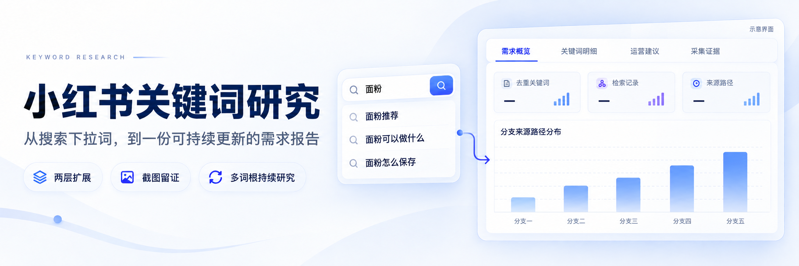

# 小红书下拉关键词采集 Skill



给 AI Agent 一个商品词，让它操作真实浏览器，采集小红书搜索框的两层下拉联想词，截图留证并整理成 Excel。适用于不同类目的电商关键词整理，不限定烘焙。

**这是 Agent 技能，不是独立爬虫或浏览器扩展。** 浏览器操作由安装该技能的 Agent 执行；仓库中的 Python 脚本负责验证记录与导出表格，不会自行打开网页。

## 能做什么

- 输入一个或多个词根，采集第一层联想词，再逐个输入第一层词采第二层。
- 保存真实截图、下拉位置、时间与来源路径，去重但不丢失路径。
- 每次采集保存 JSON 检查点，续采保留完成项；受阻及未完成项如实列出。
- 导出关键词表、采集记录、截图索引、去重词库、待采集五张表。
- 可选通用电商解读：购买渠道、选购比较、商品信息、使用方法、售后等分类；采购意图/内容价值评分及运营检查建议。

联想词不是搜索量、热度、销量或成交预测。评分和建议是规则推断，未覆盖的词留给人工判断。不要把词条直接当成商品事实或销售承诺。

## 安装与前提

### 默认浏览器方案：BrowserSkill（需另行安装）

本项目默认按 BrowserSkill 方案指导真实浏览器采集，**下载本仓库不会自动安装 BrowserSkill**。同机使用时需要三部分：`bsk` CLI、本机 Chrome/Edge 的浏览器扩展、所用 Agent 能发现的 `browser-skill` 技能。缺少任何一环都不能认定已具备采集条件。

请按 [BrowserSkill 官方安装指南](https://github.com/Tencent/BrowserSkill/blob/main/AGENT_INSTALL.md) 配置，不在此仓库复制第三方安装程序或扩展包。浏览器扩展由用户安装并确认连接；安装后检查 `bsk --version`、`bsk doctor`、Agent 能否读取 browser-skill，再实际读取一个普通网页并结束测试会话。doctor 无失败不等于完整安装已验证。

可把这句话交给 AI：

> 先按 BrowserSkill 官方安装指南检查 CLI、浏览器扩展和当前 Agent 的 browser-skill。缺少时告诉我怎么安装，不要假定已连接。确认可操作网页后，再运行小红书关键词采集；登录和验证码由我处理。

只有浏览器扩展不够，只有本项目 Skill 也不够。若已有符合截图、可见页面和检查点要求的其他浏览器工具，可沿用，不强制重复安装。**没有浏览器工具仍能用已有 capture.json 导出 Excel/HTML，但不能采集新词。** 本项目不包含登录状态，不自动取得用户浏览器访问授权。

1. 下载仓库（Code → Download ZIP），将解压后的目录作为一个 Skill 放入 Agent 的技能目录。Codex 通常为 `$CODEX_HOME/skills/yao-geo-xiaohongshu`；未设置 CODEX_HOME 时通常使用 `~/.codex/skills/yao-geo-xiaohongshu`。避免同时安装原版和此版造成同名冲突。
2. 按所用 Agent 的要求刷新技能或重开对话，确认它能读取 `SKILL.md`。
3. 配好该 Agent 可用的浏览器操作工具。本次实测使用腾讯开源的 [BrowserSkill](https://github.com/Tencent/BrowserSkill)，参考其[中文说明](https://github.com/Tencent/BrowserSkill/blob/main/README.zh-CN.md)与[官方安装指南](https://github.com/Tencent/BrowserSkill/blob/main/AGENT_INSTALL.md)。需要本地 `bsk` CLI/连接程序、浏览器扩展以及 Agent 侧的 browser-skill 配合使用，扩展单独安装不能完成整套流程。本项目不捆绑这些组件，也不代替它们的安装与连接检查；其他浏览器工具须符合本 Skill 的证据与操作要求。
4. 准备 Python 3.10+，安装导出依赖：

```bash
python -m pip install -r requirements.txt
```

本项目代码使用 MIT 许可证。运行时的 AI 模型、浏览器工具和其他服务可能有各自费用，不承诺整个运行链路免费。

## 对 Agent 这样说

> 帮我采集小红书“我的商品词”的下拉联想词，做两层扩展，保留截图并导出 Excel。遇到登录或验证码叫我，最后告诉我哪些没采完。

Agent 检查浏览器连接后打开小红书；登录和验证码由你处理。登录正常后采词、截图、记录检查点并导出。默认最多200个不同检索词，每个下拉最多10个可见词，不扩到第三层。出现平台限制时暂停，不绕过验证码或访问控制。

只要关键词表时，不必要求电商分析；需要时再说“按我的商品类目做通用电商解读”。通用规则不等于所有类目的专用知识。

## 从已有记录导出

### 持续更新同一份 HTML

```bash
python scripts/research_project.py --project "我的关键词研究" --input "本轮采集/capture.json"
```

每轮沿用同一个 `--project` 目录，固定更新 `小红书关键词研究.html`。只有想建立独立研究时才换一个项目目录。报告沿用清爽蓝紫风格，支持词根/全部词根、历史批次、关键词筛选、柱图与数据表、截图证据。第三方网页与真实登录截图未随仓库提供。

同一批 JSON 重复导入不新增批次；失败批次不会替换此前完整批次。原始记录保存于 `research-project.json`，截图按内容去重。新词默认“待解读”，不自动捏造运营结论。分享完整项目文件夹才包含截图，公开前务必人工脱敏。详见 [研究项目规则](references/research-project.md)。

```bash
python scripts/check_research_project.py
```

将 `capture.json`、`evidence/` 截图目录和输出 Excel 放在同一目录。格式见 [数据契约](references/data-contract.md)。

```bash
python scripts/build_workbook.py --input capture.json --output keywords.xlsx --industry ecommerce
python scripts/build_ecommerce_workbook.py --input capture.json --output ecommerce.xlsx
```

增强表输出新文件名，保留原五张表，另加四张解读表。烘焙专用脚本仅是可选案例，不是通用默认规则。

## 检查

```bash
python scripts/check_scoring.py
python scripts/check_workbook.py
python scripts/check_ecommerce.py
python scripts/check_baking.py
```

这些是离线检查，不验证当前平台页面结构。真实采集后仍应核对截图、输入值、顺序和来源。仓库不包含私人账号截图、Cookie、登录信息或实测采集数据。

## 来源与改进

基于 [yaojingang/yao-geo-skills 中的 yao-geo-xiaohongshu](https://github.com/yaojingang/yao-geo-skills/tree/main/skills/yao-geo-xiaohongshu) 改进，保留原版权和 MIT 许可证。原版提供两层采集规程、证据记录、行业评分与五表导出；此版新增可选通用电商解读、双评分、运营建议、烘焙案例与相应检查，并明确采集与解读的边界。
# 评分配色

Excel 评分列采用红黄绿辅助阅读：1–3分红色、4–6分黄色、7–10分绿色。基础表商业分及可选解读表三种分数均着色，保留原数值，并用条件格式支持修改分数后的颜色更新。颜色仅表示规则评分区间，不代表搜索量、热度或成交效果；低采购意图不等于低内容价值。
